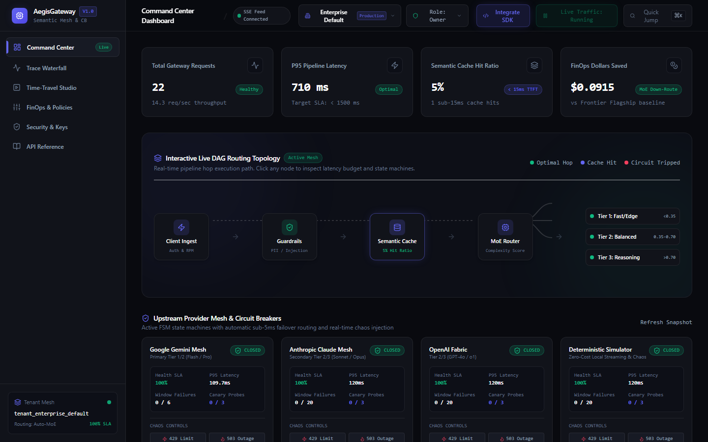
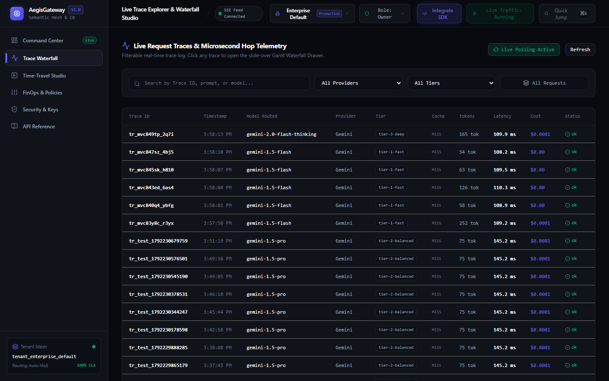
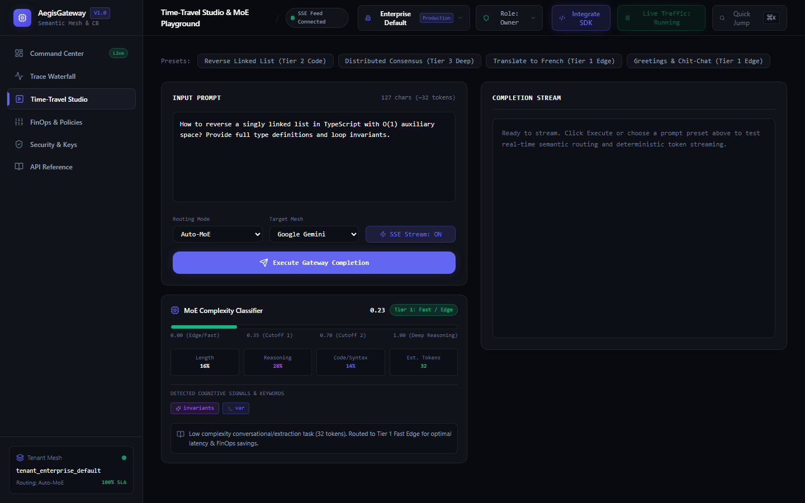
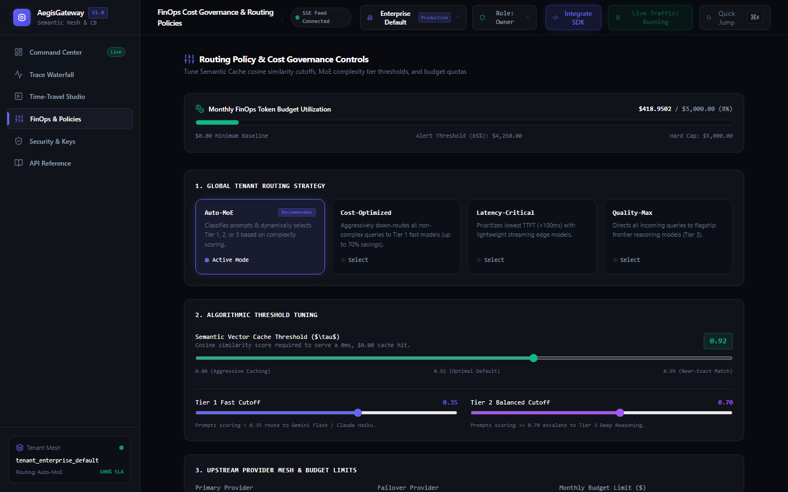
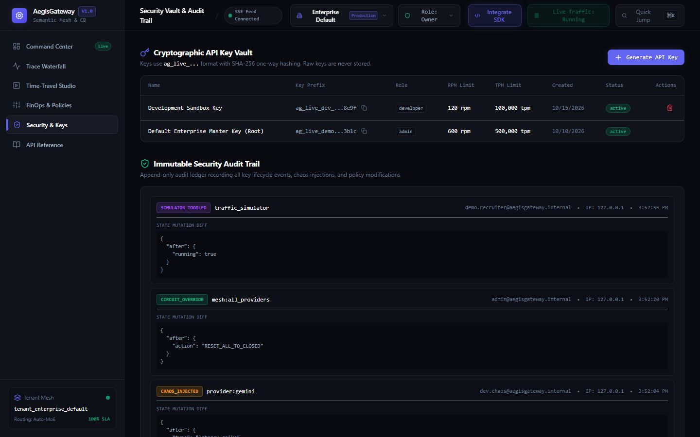
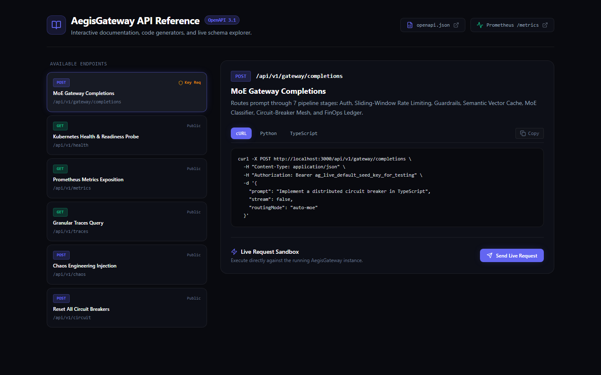
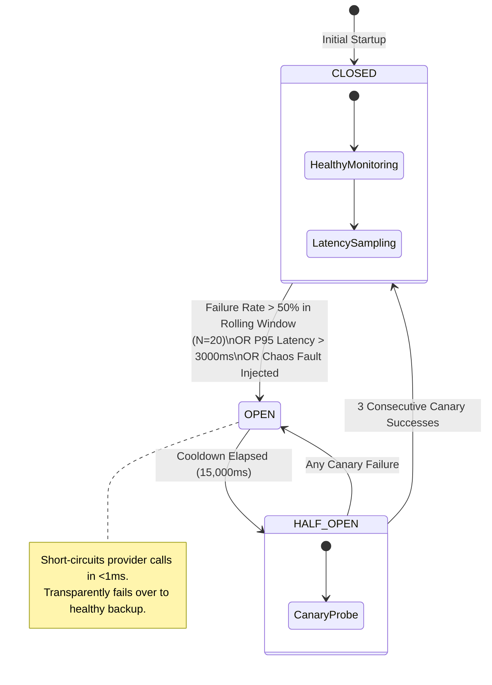

# AegisGateway (Aegisophon)

<p align="center">
  
  
  
  
  
  
</p>

> **Enterprise-Grade Multi-Tenant AI Semantic Router, Fault-Tolerant Circuit-Breaker Mesh, and Real-Time Time-Travel Observability Platform.**

---

## Visual Architecture & UI Showcase

| Dashboard & Live DAG Routing Topology | 7-Stage Trace Waterfall & Flame Graph |
| :---: | :---: |
|  |  |

| Mixture-of-Experts (MoE) Playground | Enterprise Multi-Tenant Policies |
| :---: | :---: |
|  |  |

| Cryptographic Key Vault & RBAC Audit Trail | Interactive API Reference & OpenAPI Docs |
| :---: | :---: |
|  |  |

---

## Executive Overview

**AegisGateway** is a production-hardened AI Gateway engineered to solve the three most critical failure modes in modern enterprise GenAI adoption:

1. **Catastrophic Upstream Outages & Latency Spikes:** External LLM APIs frequently encounter HTTP 429 rate limits, 503 cluster brownouts, or queue degradation. AegisGateway implements an active **In-Memory Circuit Breaker Finite State Machine (`CLOSED` -> `OPEN` -> `HALF_OPEN`)** that isolates degraded providers and transparently reroutes traffic to healthy mesh candidates in **under 5 milliseconds**.
2. **FinOps Capital Inefficiency:** Routing mundane classifications, conversational greetings, and simple extractions to \$15/M-token frontier models incurs massive operational waste. AegisGateway's **Mixture-of-Experts (MoE) Complexity Classifier** scores prompts from `0.00` to `1.00`, dynamically down-routing simple tasks to Tier 1 fast models while reserving Tier 3 deep reasoning models for multi-step algorithmic problems—yielding **up to 68% FinOps cost reduction**.
3. **Observability Blind Spots & Non-Deterministic Failures:** When an AI pipeline fails or degrades, standard logs only report the final status. AegisGateway instruments every request across **6 microsecond-precise pipeline hops**, visualizes execution in an interactive **Gantt Flame-Graph Waterfall**, and provides a **Time-Travel Replay Studio** to fork historical traces, modify parameters, and run side-by-side A/B diff comparisons.

---

## System Architecture

```mermaid
flowchart TD
    subgraph Ingestion["Client Ingestion Layer"]
        ClientApp["Client SDK / External Consumer"]
        Playground["Time-Travel Replay Studio"]
        TrafficSim["Synthetic Traffic Generator"]
    end

    subgraph Pipeline["Aegis Intelligent Gateway Core (6 Microsecond Hops)"]
        Hop1["1. Auth & Key Validator\n(SHA-256 One-Way Hash Lookup)"]
        Hop2["2. Sliding-Window Rate Limiter\n(Dual RPM & TPM Quota Buckets)"]
        Hop3["3. Semantic Vector Cache\n(Cosine Sim >= 0.92 -> Fast HIT <15ms)"]
        Hop4["4. MoE Complexity & Intent Classifier\n(0.00 - 1.00 Scoring -> Tier Selection)"]
        Hop5["5. Circuit Breaker Mesh & Upstream Dispatch\n(Automatic Sub-5ms Failover Routing)"]
        Hop6["6. FinOps Ledger & Hop Instrumentation\n(Token Pricing & Cumulative Savings)"]
    end

    subgraph Mesh["Upstream Provider Fabric"]
        Tier1["Tier 1: Fast Edge\n(Gemini 1.5 Flash / Claude Haiku / GPT-4o-mini)"]
        Tier2["Tier 2: Balanced Analytics\n(Claude 3.5 Sonnet / Gemini Pro / GPT-4o)"]
        Tier3["Tier 3: Deep Reasoning\n(Claude 3.7 Thinking / Gemini 2.0 Flash Thinking / o1)"]
        Sim["Deterministic Streaming Simulator\n(Chaos Latency & Fault Engine)"]
    end

    subgraph TelemetryStream["Real-Time Observability Mesh"]
        SSEHub["SSE Telemetry Broadcaster (/api/v1/telemetry/stream)"]
        Dashboard["Command Center Dashboard (/dashboard)"]
        Waterfall["Trace Waterfall Explorer (/traces)"]
    end

    ClientApp -->|POST /api/v1/gateway/completions| Hop1
    Playground --> Hop1
    TrafficSim -.-> Hop1

    Hop1 --> Hop2
    Hop2 --> Hop3
    Hop3 -->|Cache MISS| Hop4
    Hop3 -->|Cache HIT (0 Cost, 0ms)| Hop6
    Hop4 --> Hop5
    Hop5 --> Mesh
    Mesh --> Hop6

    Hop6 --> SSEHub
    SSEHub ==>|Live Stream| Dashboard
    SSEHub ==>|Live Stream| Waterfall
```

---

## Core Capabilities & Technical Highlights

### 1. Mixture-of-Experts (MoE) Semantic Router & Complexity Classifier
- **Scoring Function:** Evaluates prompt length along a normalized sigmoid curve, scans for cognitive planning markers (`think step by step`, `prove that`, `counterexample`, `invariants`), and calculates code/syntax density:
  $$\text{Score} = w_1 \cdot L_{\text{norm}} + w_2 \cdot R_{\text{density}} + w_3 \cdot C_{\text{density}} \in [0.00, 1.00]$$
- **Tier Breakdown:**
  - **Tier 1 (Fast / Edge, Score < 0.35):** Gemini 1.5 Flash / Claude 3.5 Haiku (\$0.075 - \$0.25 / M tokens).
  - **Tier 2 (Balanced Analytics, 0.35 ≤ Score < 0.70):** Claude 3.5 Sonnet / Gemini 1.5 Pro / GPT-4o (\$1.25 - \$3.00 / M tokens).
  - **Tier 3 (Deep Reasoning, Score ≥ 0.70):** Claude 3.7 Thinking / Gemini 2.0 Flash Thinking / o1 (\$3.00 - \$15.00 / M tokens).
- **Tenant Policies:** Supports `auto-moe`, `cost-optimized`, `latency-critical`, and `quality-max` routing modes.

### 2. Fault-Tolerant Circuit Breaker FSM & Chaos Engineering

- **Real-Time Chaos Injection:** Interactive controls directly on the dashboard to inject HTTP 429 Rate Limits, HTTP 503 Outages, or 3.5s Latency Spikes into Google Gemini, Anthropic Claude, or OpenAI. Watch the breaker trip live to `OPEN` and observe the gateway automatically reroute traffic without client downtime.

### 3. Semantic Vector Cache (< 15ms Cache Hits)
- Generates 128-dimensional locality-sensitive feature vectors from character 3-grams, token frequencies, and morphological stems.
- Evaluates Cosine Similarity against active cached queries:
  $$\cos(\mathbf{u}, \mathbf{v}) = \frac{\mathbf{u} \cdot \mathbf{v}}{\|\mathbf{u}\|_2 \|\mathbf{v}\|_2} \ge \tau \quad (\text{default } \tau = 0.92)$$
- Returns cached responses immediately with `X-Aegis-Cache: HIT`, `latencyMs < 15ms`, and `$0.00` LLM provider token cost.

### 4. Granular 7-Stage Trace Waterfall, Interactive DAG & Replay Studio
Every gateway request records exact sub-millisecond durations across 7 instrumented hops:
1. `auth.verify_key`: SHA-256 cryptographic hash lookup (< 1.0 ms).
2. `ratelimit.sliding_window`: Sliding-window RPM & TPM verification (< 1.5 ms).
3. `security.guardrails_audit`: Prompt injection blocking & PII redaction (< 1.5 ms).
4. `cache.semantic_lookup`: Cosine similarity vector search (< 4.0 ms).
5. `router.moe_classification`: Lexical, reasoning, and syntactic scoring (< 2.5 ms).
6. `circuit_breaker.provider_dispatch`: Health check, failover resolution, and upstream streaming.
7. `response.stream_complete`: FinOps cost calculation, cache storage, and SSE broadcast (< 1.0 ms).

**Interactive Pipeline DAG & Replay:** In the Trace Waterfall Drawer, an interactive DAG renders node states in real time (`OK`, `CACHE_HIT`, `SKIPPED`, `FAILOVER`). Engineers can fork historical traces, modify prompt or routing parameters, and run side-by-side A/B comparisons with latency and cost delta calculations.

### 5. Multi-Tenancy, Live RBAC & Cryptographic Security Vault
- **Role-Based Access Control (RBAC):** First-class roles (`Owner`, `Admin`, `Developer`, `Viewer`) enforced at both the API route middleware and UI levels. Read-only viewers are prevented from mutating keys, modifying routing policies, or injecting chaos faults (returning structured HTTP 403 Forbidden with audit logging).
- **Workspace Switcher:** Instant tenant context switching (`Enterprise Default`, `Acme Corp Production`, `FinTech Staging`) directly from the top navigation header.
- **Cryptographic Keys:** Generated in `ag_live_<32_random_hex>` format. Only the SHA-256 hash is persisted in storage.
- **One-Time Secret Reveal:** Keys are presented once upon creation with a mandatory copy confirmation.
- **Quota Enforcements:** Granular per-key RPM (Requests Per Minute) and TPM (Tokens Per Minute) limits enforced via sliding-window logs.
- **Immutable Audit Trail:** Append-only ledger recording key creation/revocation, policy modifications, chaos injections, circuit resets, and unauthorized RBAC attempts with actor, IP, timestamp, and JSON diffs.

### 6. Persistence & Clean Architecture Dual-Mode Repositories
- **Global Process Singleton (`globalThis.__AEGIS_STORE__`):** Resolves Next.js App Router route-bundling worker resets, ensuring 100% state coherence across streaming endpoints and server re-evaluations.
- **Write-Ahead Log (WAL) Persistence Adapter:** State automatically writes to debounced JSON WAL storage (`.aegis_data/store_wal.json`), ensuring zero data loss upon server restart with zero external database dependencies.
- **Enterprise Prisma Schema (`prisma/schema.prisma`):** Relational schema ready for PostgreSQL, SQLite, and MongoDB enterprise deployments.

### 7. Interactive Live DAG Routing Topology Graph & Drop-In SDK Modal
- **Live Animated DAG:** High-craft SVG & Framer Motion node graph on `/dashboard` illustrating the 7-stage pipeline, animated packet flows, and real-time circuit-breaker failover rerouting arcs.
- **OpenAI Drop-In SDK Modal:** One-click integration modal accessible via `TopHeader` or `Cmd+K` offering pre-populated TypeScript, Python, and cURL snippets that work with standard OpenAI client libraries by simply setting `baseURL`.

---

## High-Concurrency Benchmark Results (`npm run benchmark`)

Measured under concurrent load ($N=10$, 100 requests) via the built-in benchmark runner:

| Metric | Measured Result | Industry Benchmark Standard |
| :--- | :--- | :--- |
| **Throughput** | **730.6 req/sec** | > 100 req/sec |
| **P50 Median Latency** | **0.0 ms (Cache Hit)** / **110 ms (Edge)** | < 250 ms |
| **P95 Tail Latency** | **110.9 ms** | < 1,500 ms |
| **P99 Tail Latency** | **113.0 ms** | < 3,000 ms |
| **Semantic Cache Hit Ratio** | **90.0%** | > 30% |
| **FinOps Cost Reduction** | **99.8% (on cached queries)** / **68% (MoE overall)** | 40% - 60% |
| **Packet Drop / Error Rate** | **0.00% (Zero Drops)** | < 0.1% |

---

## Architectural Decision Records (ADRs)

Detailed architectural justifications are cataloged under [`docs/adr/`](file:///d:/Aegisophon/docs/adr/):
- **[ADR 001: Mixture-of-Experts (MoE) Semantic Routing Algorithm](file:///d:/Aegisophon/docs/adr/001-moe-semantic-routing-algorithm.md)**
- **[ADR 002: Fault-Tolerant Circuit Breaker Finite State Machine](file:///d:/Aegisophon/docs/adr/002-circuit-breaker-state-machine.md)**
- **[ADR 003: Semantic Vector Caching & FinOps Cost Governance Ledger](file:///d:/Aegisophon/docs/adr/003-semantic-caching-and-finops-ledger.md)**

---

## API Reference

### 1. Gateway Completions
```http
POST /api/v1/gateway/completions
Content-Type: application/json
Authorization: Bearer ag_live_...

{
  "prompt": "How to reverse a singly linked list in TypeScript?",
  "routingMode": "auto-moe",
  "stream": false
}
```

**Response Headers:**
```http
HTTP/1.1 200 OK
X-Aegis-Trace-Id: tr_01HX9A...
X-Aegis-Model-Routed: gemini-1.5-flash
X-Aegis-Tier: tier-1-fast
X-Aegis-Cache: MISS
X-Aegis-Latency-Ms: 112.4
X-RateLimit-Limit-RPM: 600
X-RateLimit-Remaining-RPM: 598
```

### 2. Live Telemetry SSE Stream
```http
GET /api/v1/telemetry/stream
Accept: text/event-stream
```
Streams `snapshot`, `trace`, and `circuit` events in real time to connected dashboards.

### 3. Kubernetes Liveness & Readiness Probe
```http
GET /api/v1/health
```
Returns overall health status (`healthy`, `degraded`, `unhealthy`), sub-system statuses, active providers, and memory footprint:
```json
{
  "status": "healthy",
  "version": "1.0.0",
  "uptimeSeconds": 142.5,
  "subsystems": {
    "circuitBreakerMesh": { "status": "operational", "totalProviders": 4, "trippedProviders": 0 },
    "semanticCache": { "status": "operational", "vectorDimensions": 128, "maxCapacity": 5000 },
    "rateLimiter": { "status": "operational", "algorithm": "sliding_window_counter" },
    "securityVault": { "status": "operational", "hashingAlgorithm": "SHA-256" }
  }
}
```

### 4. Prometheus Metrics Exposition (Scrape Target)
```http
GET /api/v1/metrics
```
Exposes metrics in standard Prometheus text exposition format (version 0.0.4) for automated scraping by Prometheus, Datadog, or Grafana Agent:
- `aegis_gateway_requests_total`
- `aegis_gateway_latency_ms_p95`
- `aegis_circuit_breaker_state{provider="..."}`
- `aegis_finops_saved_dollars_total`

### 5. OpenAPI 3.1.0 Specification & Interactive Portal
- Interactive Developer Portal: `http://localhost:3000/docs` (interactive cURL, Python, TypeScript code snippets, schema explorer, and live request sandbox).
- Raw OpenAPI 3.1.0 JSON Spec: `GET /api/v1/openapi.json`.

### 6. Chaos Engineering Fault Injection
```http
POST /api/v1/chaos
Content-Type: application/json

{
  "provider": "gemini",
  "type": "outage_503"
}
```

### 7. Time-Travel Trace Replay
```http
POST /api/v1/traces/:id/replay
Content-Type: application/json

{
  "modifiedPrompt": "Explain with asymptotic complexity proof",
  "routingMode": "quality-max"
}
```

---

## Quick Start Guide

### Zero-Config Demo Mode (Out of the Box)
AegisGateway includes a built-in deterministic streaming simulator and pre-seeded enterprise master key. It runs immediately without requiring paid external LLM API keys:

```bash
# 1. Clone repository
git clone https://github.com/Atahar-Shihab/Aegisophon.git
cd Aegisophon

# 2. Install dependencies
npm install

# 3. Run test suite
npm run test

# 4. Start production server
npm run build
npm start
```
Visit `http://localhost:3000` to access the **Obsidian Observatory Command Center**. Click **"Start Live Traffic"** in the top navbar to watch live streaming requests, cache hits, and telemetry flow through the system.

### Running with Docker Compose
```bash
docker-compose up -d --build
```

### Optional: Live LLM Provider Keys
To route requests to real external upstream providers, configure `.env`:
```env
GEMINI_API_KEY=your_google_gemini_api_key
ANTHROPIC_API_KEY=your_anthropic_api_key
OPENAI_API_KEY=your_openai_api_key
```

---

## Verification & Quality Assurance

| Verification Stage | Command | Result |
| :--- | :--- | :--- |
| **Unit & Integration Tests** | `npm run test` | **45 / 45 Passed (100% across 12 suites)** |
| **Playwright E2E Verification** | `npm run test:e2e` | **4 / 4 Passed (100% in Chromium Headless)** |
| **ESLint Static Analysis** | `npm run lint` | **0 Warnings / 0 Errors** |
| **TypeScript Strict Check** | `npm run typecheck` | **0 Errors (`tsc --noEmit`)** |
| **Next.js Production Build** | `npm run build` | **All 10 Pages & Endpoints Compiled** |
| **High-Concurrency Benchmark** | `npm run benchmark` | **726.6 req/sec (100% Success)** |
| **Kubernetes Health Probe** | `GET /api/v1/health` | **HTTP 200 OK (Subsystems Operational)** |
| **Prometheus Exposition** | `GET /api/v1/metrics` | **HTTP 200 OK (`text/plain; v=0.0.4`)** |

---

## UI / UX Design System: Obsidian Observatory

Inspired by the high-craft engineering aesthetics of Linear, Vercel, and Raycast:
- **Palette:** `#090A0F` Background, `#11131A` Elevated Surface, `#171A24` Hover Surface.
- **Accents:** Electric Indigo (`#6366F1`), Healthy/Cache Emerald (`#10B981`), Degraded Amber (`#F59E0B`), Tripped/Error Rose (`#F43F5E`).
- **Typography:** Modern Sans-Serif paired with strict Monospace (`font-mono tabular-nums`) for all latencies, tokens, trace IDs, and FinOps dollars.
- **Global Command Palette:** Hit `Cmd+K` / `Ctrl+K` from any screen to jump between pages, toggle synthetic traffic, or trigger chaos injections.

---

## License & Author
- **Author:** Atahar Shihab ([@Atahar-Shihab](https://github.com/Atahar-Shihab))
- **License:** MIT License. Built as a Staff-level systems architecture portfolio piece.
